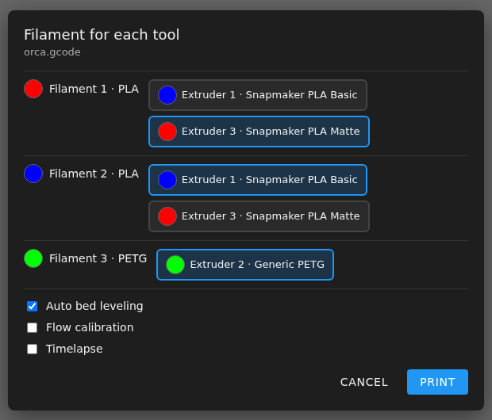

# Filament Mapping for Web Prints

Starting a print from **Fluidd** or **Mainsail** asks the same questions as
the touchscreen:

- Which loaded filament to use for each filament (tool) in the file. Only
  extruders loaded with the same material are offered, showing their colors.
- Auto bed leveling, flow calibration and timelapse.

The printer gets the same request as from the touchscreen, so the mapping and
the material and nozzle checks work the same way. The printer saves the
switch values, and the dialog uses them as the next print's defaults.

## How Defaults Are Chosen

Each filament is paired with the matching-material extruder of the closest
color, using each extruder once while any are free. Colors are compared the
same way the printer compares them for auto-replenish. The switches start
from the values used for the last print.

**Print** stays disabled until every filament has an extruder. If no
extruder has the material loaded, load or edit one first. The dialog does not
offer a different material.

If the printer refuses the print (for example nozzle size mismatch), the
reason is shown in the dialog. Adjust the choices and try again, or cancel.

## When the Dialog Is Skipped

The print starts directly, as before, when:

- The file has no per-filament information (not sliced with Snapmaker Orca or
  OrcaSlicer).
- The printer is already printing or paused.
- Fluidd's printer switcher is showing another printer.

**Upload & Print** in Fluidd and Mainsail starts the print as part of the
upload, so it does not show the dialog. Upload first, then print the file
from the file list.

## Technical Details

`/firmware-config/print-map.js` is added to Fluidd's and Mainsail's
`index.html` at build time (`scripts/helpers/inject_print_map.sh`). It holds
the UI's `printer.print.start` request and starts the print with Moonraker's
`server.files.start_local_print` instead (websocket only, Moonraker does not
offer it over HTTP), with `map_table`, `bed_level`,
`flow_calibrate`, `flow_calibrate_extruders` and `time_lapse_camera`. That
is the same call the touchscreen makes, and it runs
`SDCARD_PRINT_FILE_WITH_PARAMETERS`. Check the result with
`GET_PRINT_EXTRUDER_MAP` in the console.

The browser test is
`overlays/firmware-extended/02-firmware-config/test/test_print_map.py`
(needs Python Playwright).
